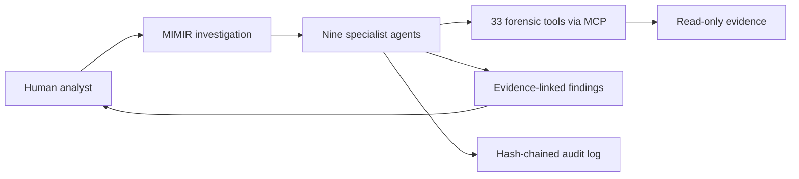

# MIMIR — design note and synthetic investigation example

> **Scope:** This page describes MIMIR's design and uses fictional lab artifacts to illustrate an evidence-first investigation. It does not show a MIMIR execution or a current test result. The source repository and real case material remain private.

MIMIR is a multi-agent digital forensics and incident response project built for the SANS Find Evil! 2026 hackathon. Its guiding question: how can agents accelerate an investigation while leaving evidence intact and the analyst in control?

## The investigation problem

An investigation can span memory, disk, logs, network traffic, and suspicious files. An analyst needs to correlate those views, retain the provenance of each observation, and separate a plausible lead from a supported finding. MIMIR divides that work among bounded specialists while keeping the final judgment with a human.

## Design at a glance

The project design calls for nine specialist agents and 33 forensic tools exposed through MCP. Its stated controls include read-only evidence access, hash-chained tool logs, evidence-linked findings, and human approval gates. This conceptual diagram omits private implementation details.

The analyst starts the investigation. Specialists use scoped tools to examine evidence, record observations and provenance, then return findings for human review.

## Fictional investigation example

**This is a reasoning example, not MIMIR output.** On a made-up workstation, a process event shows PowerShell started with an encoded command. A DNS record and a network record follow within seconds:

| ID | Fabricated artifact | Observation |
| --- | --- | --- |
| LAB-01 | Process event | PowerShell launched with an encoded command on `LAB-WS01`. |
| LAB-02 | DNS event | `LAB-WS01` queried `sync.example.invalid`. |
| LAB-03 | Network event | `LAB-WS01` contacted `203.0.113.10`. |

The domain and IP address are reserved for examples ([RFC 2606](https://www.rfc-editor.org/info/rfc2606/), [RFC 5737](https://www.rfc-editor.org/info/rfc5737/)).

An evidence-bound finding would describe the suspicious process-and-network sequence, cite LAB-01 through LAB-03, and ask the analyst to inspect the decoded command and surrounding timeline. These artifacts alone do not establish exfiltration, attacker identity, or a malware family.

## Validation status

This page shows the proposed reasoning standard and architectural controls. A public MIMIR run on synthetic evidence and a current test receipt are still needed to demonstrate the implementation. The private project's earlier test count is omitted here because it has not been rerun for this release.

A future demo should show the synthetic inputs, evidence-linked finding, audit-chain verification, human approval point, revision, and test command. It must exclude workplace, client, and real case data.

## Limits

This design note makes no claim of incident-response accuracy, court admissibility, benchmark performance, or production deployment. It does not publish private source code or case material.

For a walkthrough or collaboration, contact [Layton on LinkedIn](https://www.linkedin.com/in/isaiah-a-a3a70b181/) or [by email](mailto:Th3cyberguy@gmail.com).
